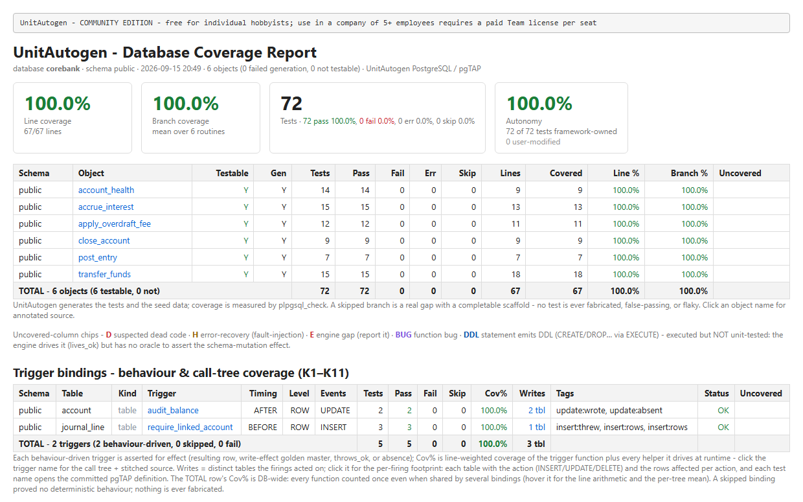
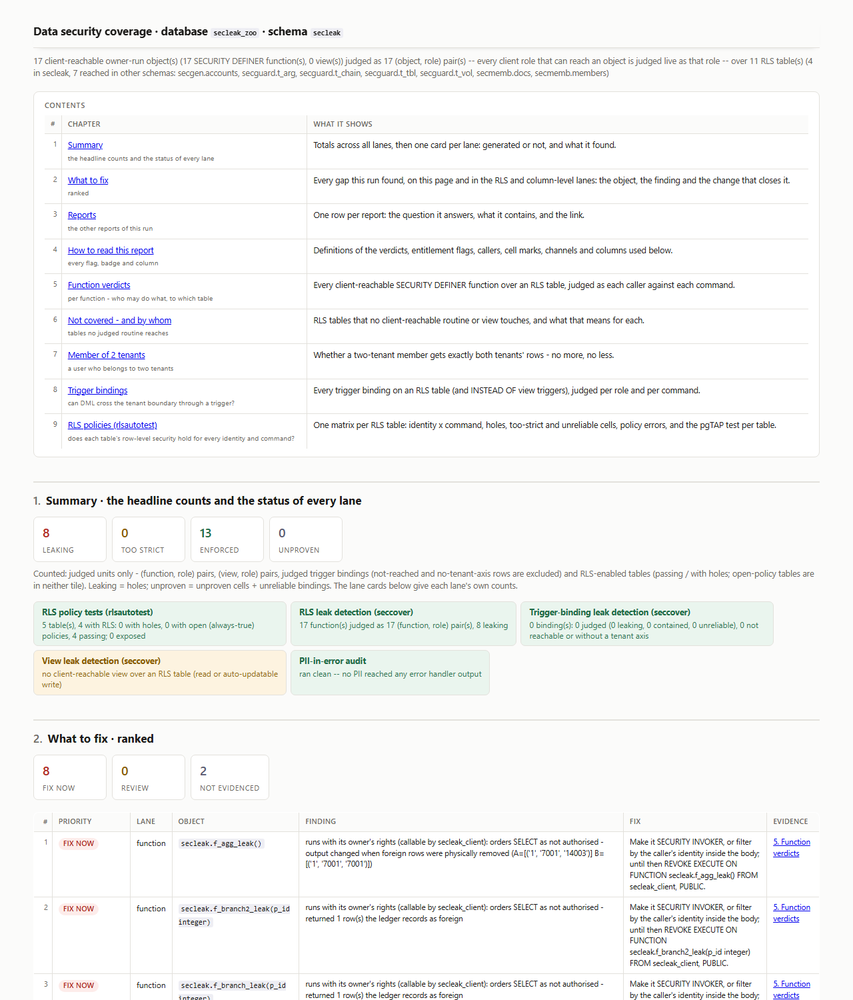

# UnitAutogen for PostgreSQL

> Your application is tested. The logic inside your database usually is not.
> UnitAutogen writes the tests for it.

**Beta (v0.3.2)** · PostgreSQL 14-18 · Windows and Linux · Community Edition (free), with Team and Enterprise modules on top.

Your application has a test suite. The functions, procedures and triggers running *inside* your PostgreSQL database almost certainly do not, and it is not because your team is lazy. Testing database logic by hand means crafting seed data that forces each `IF`, `CASE`, `EXISTS` and exception path to run, one branch at a time. It is tedious enough that it rarely gets done, so the most critical logic you ship, the code closest to your data, goes out untested and breaks quietly: a wrong `WHERE`, a missing `INSERT`, a branch that never once executed.

UnitAutogen does that work for you. Point it at a database and it generates the tests, and the data that drives each branch, as standard [pgTAP](https://pgtap.org/), runs them, and reports honest branch coverage. No test written by hand. We generate the tests, not just synthetic data: every generated test asserts a real, observed effect.



## The guardrail for AI-written database code

AI assistants now write a lot of database logic, and they write it fast. That is exactly where a silent mistake costs the most, and where it is hardest to catch by eye.

Say you ask your AI editor to adjust the tiers in a `membership_tier` function. The edit reads fine, so you approve it, but it flipped one boundary:

```diff
-    ELSIF p_points >= 1000 THEN RETURN 'gold';
+    ELSIF p_points >  1000 THEN RETURN 'gold';
```

Now a customer with exactly 1000 points silently drops from gold to the tier below, the kind of thing no code review catches. But UnitAutogen already captured how that function behaved when it was correct, as standard pgTAP tests you committed, so the change fails one of them before it ships:

```
not ok 7 - membership_tier :: p_points = 1000
    #   have: silver
    #   want: gold
```

That is the guardrail. It pins today's behaviour as a test suite you did not have to write, so the next change, from an AI or a person, that moves that behaviour fails in CI instead of in production. Because the tests are generated, it keeps pace with code produced faster than anyone could test it by hand. Integration testing extends the same net across the whole flow, functions calling functions and the triggers their writes fire.

See the full [worked example](docs/worked-example.md), or [how to set it up](docs/ai-guardrail.md) in a Supabase and AI-editor workflow.

Unit testing is free and where most developers start. From there the tool climbs: **integration** testing across your functions, and **seccover**, a full security-coverage pass that checks whether your row-level security and multi-tenant isolation actually hold and whether personal data leaks through error messages. More on that below.

## The one guarantee

UnitAutogen never gives you a fabricated, false-passing, or flaky test. If a branch cannot be tested reliably, the report tells you so, in plain language, rather than showing a green that would mislead you. So every report comes back with no failing and no false tests, and a visible, explained gap always beats a false pass. That is what makes the result safe to gate your CI on.

## Who it is for

UnitAutogen serves the whole path from writing database code to signing off on it, and grows from a free developer tool into enterprise-grade assurance. What you can do, and who it is for:

| Capability | Who it is for | Edition | What you get |
| --- | --- | --- | --- |
| Unit + trigger testing | Developers | Community (free) | A full pgTAP test suite plus branch/statement coverage for every function and trigger, generated and run for you. |
| Integration testing | Developers, QA | Team | Tests across your functions, run for real together, so interactions and cascades are exercised, not just units. |
| seccover | Developers, QA, tech leads / CIO, compliance | Enterprise | Proof that RLS and multi-tenant isolation are actually enforced across your functions, views and triggers, unfiltered. |
| PII audit (`--pii`) | Compliance, developers | Enterprise | Finds personal data leaking through error and `RAISE` messages. |

The Community Edition, unit and trigger testing, is the everyday developer tool and is free forever. seccover is the one that platform leads, CIOs and compliance officers care about, and the one that carries the most value, so it gets its own section next.

## seccover: prove your database actually isolates tenants

Most PostgreSQL apps that hold more than one customer's data rely on row-level security and careful function logic to keep tenant A from ever seeing tenant B. The problem is that nobody can easily *prove* it stays true as the code keeps shipping. A single new function, a `SECURITY DEFINER` helper, a policy that was loosened for a bugfix, and the isolation quietly breaks. You find out in an incident, or an audit, not in a test.

seccover is built for exactly that. It exercises your functions, views and triggers as different tenants and reports, per routine, whether isolation is **enforced** or **leaking**, with the evidence. `--pii` adds a second pass that catches personal data escaping through error and `RAISE` messages, the leak nobody writes a test for.



Two things make it procurement-grade rather than a one-off script. It is **continuous**: a full scan is meant to run on every deploy, because a database that redeploys weekly is a database whose isolation guarantees are a week stale. And it is **self-hosted with no telemetry**: nothing about your schema or data leaves your perimeter, which is usually the first question a security review asks. If you need auditable evidence that your data logic is safe, this is the module that produces it.

### Compliance evidence

Because seccover emits standard pgTAP tests and dated, reproducible reports, its output doubles as evidence you can hand to an auditor. The isolation results map onto the controls that require you to prove data is reachable only by those authorized:

- **HIPAA Security Rule, Access Control (45 CFR § 164.312(a)(1)):** per-routine evidence that electronic protected health information in a shared database is reachable only by the tenant it belongs to. Run continuously, it also supports the periodic technical Evaluation requirement (§ 164.308(a)(8)). The `--pii` pass supports the same minimum-necessary intent by catching PHI that escapes through error and `RAISE` messages.
- **SOC 2 (Trust Services Criteria):** logical access controls (CC6.1) and role-based, least-privilege access (CC6.3), plus the Confidentiality criteria (C1) where the data is sensitive. Because the scans run on every deploy, the reports show these controls operated across the audit period, not just that they were designed.

This is supporting evidence for your auditors, not a certification, and it stays inside your perimeter: seccover is self-hosted, so the proof is produced on your own infrastructure.

Compliance officers and platform leads: [contact us](mailto:hello@unitautogen.com) for a seccover evaluation on your own schema.

## Install

Download the build for your platform from the [Releases page](https://github.com/unitautogen/unitautogen-postgresql/releases), unzip it, and verify the checksum against `SHA256SUMS.txt`.

- **Windows:** `unitautogen-pg-<version>-windows-x64.zip` contains `unitautogen.exe`. Put its folder on your `PATH`, or call it by full path.
- **Linux:** `unitautogen-pg-<version>-linux-x64.tar.gz` contains the `unitautogen` binary. `chmod +x unitautogen` and put it on your `PATH`.

Same commands, flags and reports on both platforms.

> **Beta note (Windows):** the beta binary is not yet code-signed, so Windows SmartScreen may show an "unrecognized app" warning on first run. Choose "More info" then "Run anyway", or verify the SHA-256 checksum first if you prefer. Signing lands when the tool leaves beta.

Full options, including managed/cloud PostgreSQL and installing from source, are in [docs/installation.md](docs/installation.md) *(coming with the first release)* and [docs/prerequisites.md](docs/prerequisites.md).

## Prerequisites

- The `unitautogen` binary (above). One self-contained executable, no Python install.
- **PostgreSQL 14-18**, with two extensions installed *in the database you are testing*:
  - [pgTAP](https://pgtap.org/) - the framework the generated tests are written in.
  - [plpgsql_check](https://github.com/okbob/plpgsql_check) - the coverage meter.

Both are **required**. UnitAutogen checks for them first and stops with a clear message (exit code 3) naming the exact `CREATE EXTENSION` to run if either is missing, so you never get a half-finished run. It works with any PostgreSQL 14-18, self-hosted or managed, including Supabase, Neon, Amazon RDS and Aurora, and Azure Database for PostgreSQL. Setup for every platform is in [docs/prerequisites.md](docs/prerequisites.md).

## Quick start

Generating unit tests is the default action, so there is no command word:

```
unitautogen --schema public --out unit_tests --html report.html --json report.json
```

You get one `test_<routine>.sql` per function (plus behaviour tests for triggers) in `unit_tests/`, an HTML report, and a JSON summary. Run the generated tests yourself at any time:

```
psql -d mydb -c "SELECT * FROM runtests('test_transfer_funds'::name);"
```

Walkthrough with real output: [docs/quickstart.md](docs/quickstart.md).

## Documentation

| Document | What it covers |
| --- | --- |
| [Overview](docs/overview.md) | What the tool is and the four commands. |
| [Prerequisites](docs/prerequisites.md) | PostgreSQL version, pgTAP and plpgsql_check setup. |
| [Connecting to your database](docs/connecting.md) | Connection options. |
| [Quick start](docs/quickstart.md) | First run, end to end. |
| [The four commands](docs/commands.md) | Unit, integration, seccover and PII, in full. |
| [Reading the report](docs/reading-the-report.md) | How to read coverage and verdicts. |
| [Worked example](docs/worked-example.md) | A passing test and a failing test, up close. |
| [AI guardrail (Supabase)](docs/ai-guardrail.md) | Using it as a guardrail for AI-written code, step by step. |
| [CI/CD integration](docs/ci-cd.md) | Wiring it into your pipeline. |
| [Command quick-reference](docs/command-reference.md) | Every command and flag. |
| [FAQ and troubleshooting](docs/faq.md) | Common questions and fixes. |

## Editions and licensing

- **Community Edition (free, forever):** unit and trigger test generation, coverage, and CI exit-code gating. This is the everyday developer tool.
- **Team:** adds `integration`. For teams that need cross-function testing.
- **Enterprise:** adds `seccover` and `--pii`, plus support and licensed, unwatermarked, audit-ready output. This is the tier for regulated and multi-tenant products.

For Team or Enterprise licensing, contact **<licensing@unitautogen.com>**. Use of the Software is governed by the [licence terms](EULA.md).

## Privacy

UnitAutogen runs entirely on your side. There is no telemetry and no phone-home; nothing about your schema or data leaves your machine. Tests are generated against stand-in data with the shape of your real tables, so no production data is required to run it. This is what makes it safe to point at sensitive and regulated databases.

## Status

Active beta (v0.3.2). The engine has been validated at high coverage across a range of real schemas, but you will surface things on production schemas nobody has run it against yet. Bug reports are the most valuable thing you can give us right now.

## Support

- **Bug reports and feature requests:** [open an issue](https://github.com/unitautogen/unitautogen-postgresql/issues).
- **Questions:** email **<hello@unitautogen.com>**.
- **Security or vulnerability reports:** see [SECURITY.md](SECURITY.md) or email **<security@unitautogen.com>** privately.
- **Team / Enterprise licensing:** **<licensing@unitautogen.com>**.

## Related

UnitAutogen also has a SQL Server edition (built on tSQLt): [unitautogen/unitautogen-public-repo](https://github.com/unitautogen/unitautogen-public-repo). One brand, two database platforms. Learn more at [unitautogen.com](https://unitautogen.com).

---

© 2026 Munaf Ibrahim Khatri. All rights reserved. UnitAutogen™ is a trademark of Munaf Ibrahim Khatri.
