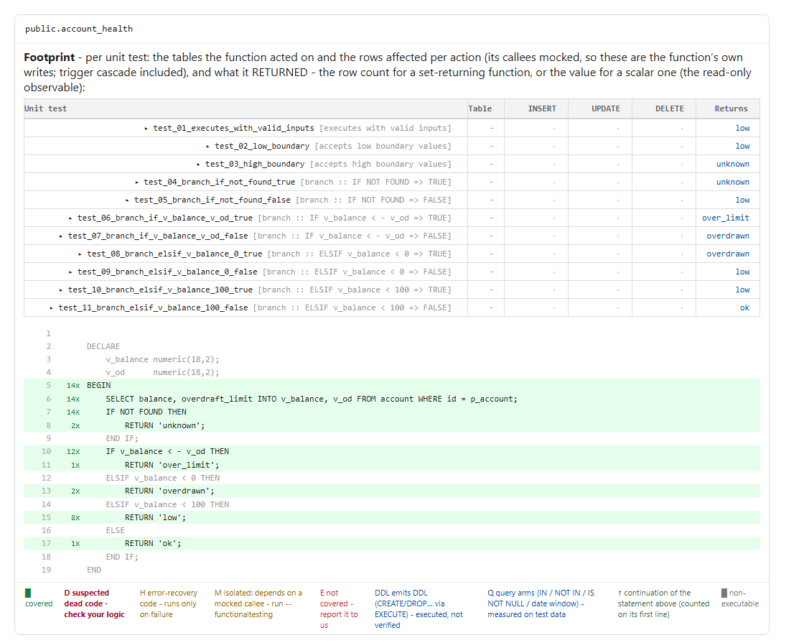
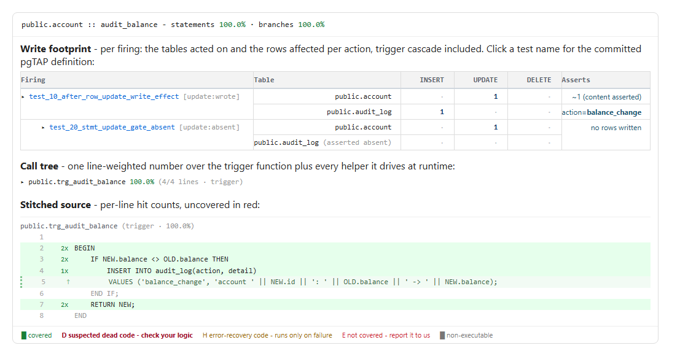
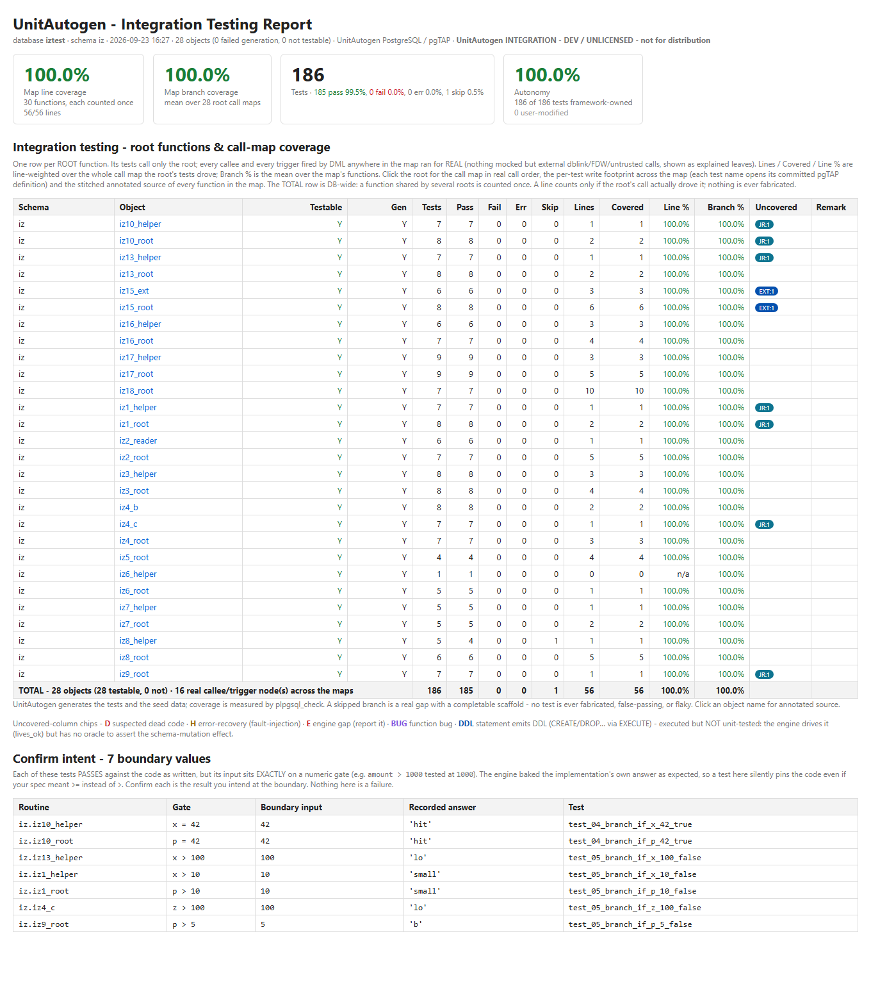
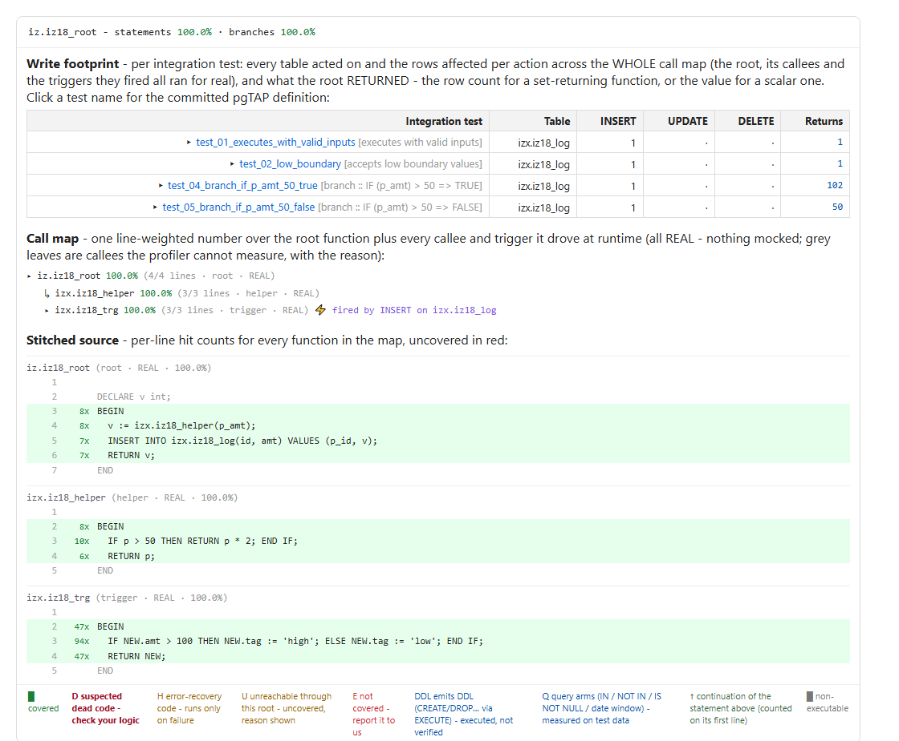
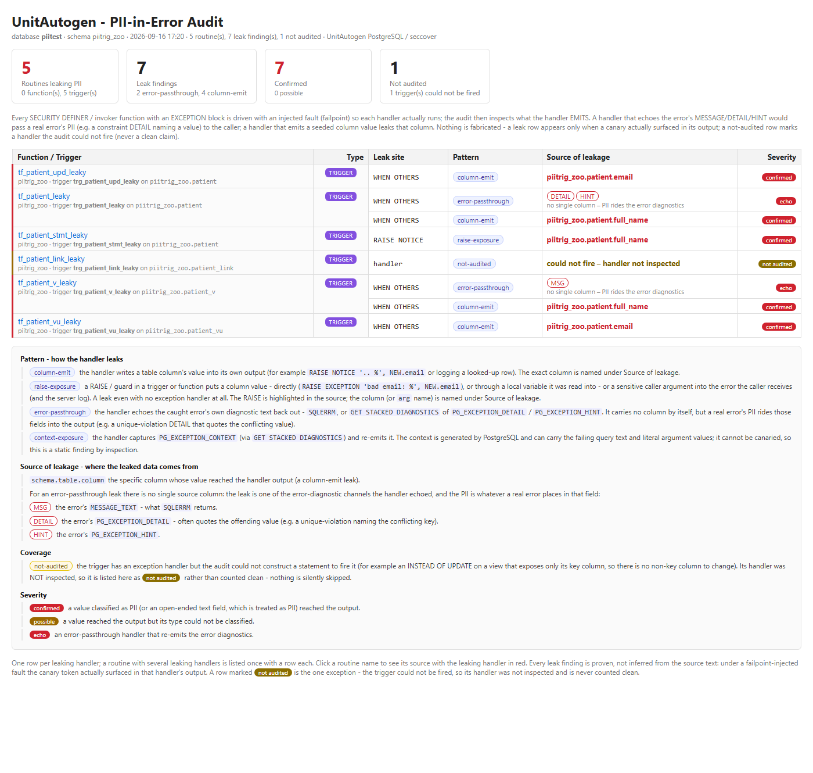

# The four commands

Run `unitautogen <command> --help` for a command's full option list. Each section
below states what the command does, its command line, the report it produces, the folder it writes to, and
whether it generates unit tests.

## 5.1 Unit tests for functions & triggers (the default command)

The everyday command - and the default, so `unitautogen --schema public` runs it with
no command word (you may also write `unitautogen unit …` explicitly). For each function and procedure it generates a full set of pgTAP tests, runs them,
and measures how much of the routine they exercised; it then does the same for your triggers. The set per
routine includes: *executes with valid inputs*, *low / high boundary values*, one test per
branch (both the true and the false side), *returns a stable result-set shape*, *returns rows
matching its recorded output*, a *hand-built expectation* scaffold for you to fill in, and
*touches only the expected tables*. Triggers are tested by behaviour - firing INSERT/UPDATE/DELETE
and asserting what the trigger did.

|  |  |
| --- | --- |
| What it does | Generates unit tests for functions **and** triggers, runs them, and measures branch/statement coverage. |
| Generates unit tests? | YES - one `test_<routine>.sql` per function, plus trigger tests under `trigger_tests/`. |
| Command | `unitautogen --schema public --out unit_tests --html report.html --json report.json` |
| Key options | `--schema a,b` schemas · `--like pat` name filter · `--out DIR` where the test files go · `--html PATH` unified HTML report · `--json PATH` machine-readable summary · `--report` also emit every CI report format (see [§8](#cicd)) · `--no-coverage` generate + run only (faster) · `--include-extension` also test extension-owned routines. |
| Report(s) | Unified **HTML** (per-routine test counts + branch%/stmt% + click-through annotated source), **JSON** summary (one entry per routine), and a per-run `_battery_summary.json`. |
| Folder | `--out` directory (default `battery_tests/`): the function tests `test_<routine>.sql`, a `trigger_tests/` sub-folder, and `_battery_summary.json`. HTML/JSON go wherever you point them. |

The JSON summary is a list with one object per routine. A representative entry:

```
{
  "proc": "public.salesbycategory",
  "tests": 7,
  "status": "ok",
  "branch_coverage": 1.0,
  "statement_coverage": 1.0,
  "tests_passed": 6,
  "tests_failed": 0,
  "tests_skipped": 1,
  "pruned": [],
  "uncovered_classes": {}
}
```

Read this as: 7 tests generated, 6 pass, 1 skipped (the hand-built-expectation scaffold, which waits for
you to fill it in), 0 failed, 0 pruned, nothing left uncovered. `tests_failed` is
**0** in every routine, always - a test that cannot pass cleanly is never committed.

### The HTML report

The `--html` file is the **Database Coverage Report** - it opens to four
summary cards and a per-routine table (click any routine name for its annotated source):


The unit report for a sample schema with 6 functions *and* 2 triggers - 72 function tests
(top table) plus 5 behaviour assertions for the triggers (the **Trigger bindings** section below it).

| Report element | What the data represents |
| --- | --- |
| Line coverage | The share of executable lines the generated tests actually ran (e.g. 16/16 lines = 100%). |
| Branch coverage | The mean, across all routines, of the true/false decision outcomes your tests covered. |
| Tests | Total generated, split into pass / fail / error / skip. *fail is always 0* - a test that can't pass cleanly is never kept; *skip* counts the hand-built-expectation scaffolds left for you to fill in. |
| Autonomy | How many tests are framework-owned versus hand-edited by you - so you can see what is generated as-is vs. customised. |
| Per-routine row | *Testable* and *Gen* (a test was produced), the *Pass / Fail / Err / Skip* counts, *Lines* & *Covered*, *Line %*, *Branch %*, and the *Uncovered* chips. |
| Uncovered chips | **D** suspected dead code · **H** error-recovery · **E** a tool limit · **BUG** a function bug · **DDL** a statement that emits DDL · **Q** a query condition your test data did not exercise on both sides (see [§6](#reading)). |
| Trigger bindings | A separate section below the function table, one row per trigger: its *Timing* (BEFORE/AFTER), *Level* (ROW/STATEMENT) and *Events* (INSERT/UPDATE/DELETE), the tests generated and their pass/fail, the trigger's own coverage *Cov %*, the tables it *Writes*, behaviour *Tags* (e.g. `update:wrote`, `insert:threw`), and *Status*. Each trigger is tested by *behaviour* - the generated test fires the DML and asserts the resulting row, the write-effect, or the error the trigger raises. A trigger with no provable behaviour is skipped honestly, never asserted vacuously. |
| Click a routine | Opens its detail: the *write footprint* per test (rows INSERTed / UPDATEd / DELETEd and what the routine returned), the *query arms* measured on the test data, and the *annotated source* - each line coloured green (covered) / red (uncovered) / dark-red (dead) / amber (not-testable), with per-line hit counts. |

A generated trigger test drives the DML and asserts what the trigger did. For the
`AFTER UPDATE` audit trigger above, the generated test fires an update and checks the
exact audit row it wrote:

```
-- generated: test_trg_account__audit_balance
UPDATE public.account SET balance = 1;                       -- Act: fire the trigger
RETURN NEXT is(
    (SELECT ... "action" FROM public.audit_log),
    '[{"action": "balance_change"}]'::jsonb,                 -- Assert: the row the trigger wrote
    'audit_balance :: update write-effect on public.audit_log');
```

### The coverage drill-down - one function and one trigger

Clicking a routine or trigger name in the report opens its coverage detail. This is where you see
*how* a routine is covered and what to do about a gap. A **function** drill-down:



`account_health` - the per-test **Footprint** (each test's writes, and its returned value:
`low` / `over_limit` / `overdrawn` / `ok`) above the
**annotated source**, every line carrying its hit count and shaded green when covered.

**How to use it:** read the annotated source top-down - a green line ran, its hit count
(e.g. `8x`) is how many tests ran it, and a *red* line never ran (with a
D/H/E tag saying whether it's a suspected bug, error-recovery code, or a tool gap). The Footprint tells you
which input produced which result, so you can confirm each branch returns what it should - and if you change
the code, the tests that pinned those values fail (see §7).

A **trigger** drill-down instead shows the per-firing effect and the trigger function's source:



`audit_balance` - the **Write footprint** per firing (test\_10 wrote an
`audit_log` row asserting `action=balance_change`; test\_20 asserted *no* row was
written), the **Call tree** of the trigger function and its helpers, and the **Stitched source** with
per-line hit counts.

**How to use it:** the Write footprint shows exactly what each firing changed - and what it
correctly did *not* change - and the stitched source shows every line of the trigger function plus any
helper it calls, so an uncovered line is a firing you haven't provoked. Click a test name in either
drill-down to open its committed pgTAP definition.

**Use unit testing to:** catch regressions (a changed behaviour fails the
pinned test), find untested branches (red lines and skips), and spot suspected bugs (a **D**-tagged line
is a contradiction in your logic). Commit the `test_*.sql` files so CI re-runs them on
every change.

## 5.2 `integration` - integration testing for functions Team license

Where unit testing checks a routine on its own, `integration` runs it together
with the functions it calls and the triggers its writes fire, for real, and measures coverage across all of
it. A function that calls nothing and fires no triggered write is "standalone": its integration result is
identical to its unit test, so it is noted as such rather than duplicated.

|  |  |
| --- | --- |
| What it does | Exercises the real cross-function / trigger call map end-to-end and measures coverage across it. |
| Generates unit tests? | YES - integration-level pgTAP tests for functions that have a real call map. |
| Command | `unitautogen integration --schema public --out integration_tests --html integration.html --json integration.json` |
| Key options | `--schema a,b` · `--like pat` · `--out DIR` · `--html PATH` · `--json PATH` · `--report` all CI formats · `--no-coverage` · `--include-extension` · `--license PATH`. |
| Report(s) | Unified **HTML** + **JSON**; a `_integration_skipped.json` listing standalone functions whose result matches their unit test. |
| Folder | `--out` directory (default `integration_tests/`). |

**Requires a Team license (or above).** Without a license the command
reports `NOT LICENSED` and does not run integration testing.
Provide a license with `--license PATH`, the `UAG_LICENSE`
environment variable, or a `unitautogen.lic` file in the working directory.

### The HTML report

The integration `--html` file is the **Integration Testing Report**. It
uses the same four summary cards, but measured across the whole call map, and its table has one row per
*root* function:



The integration report for a sample schema of interconnected routines - 18 root functions, 126 tests,
100% map coverage. Each root's tests exercise its whole call map (16 real callee/trigger nodes here);
routines that call nothing are listed as **standalone** and routed to unit testing. The **EXT:1** chip
on a root marks an external-boundary stub (e.g. a remote dblink call the map does not run).

| Report element | What the data represents |
| --- | --- |
| Summary cards | Line/branch coverage, test counts and autonomy - the same meanings as the unit report, but line-weighted over the whole call map the tests covered. |
| One row per root | A *root* is a function whose tests call it directly; every function it calls and every trigger its writes fire runs for real underneath it. |
| Remark: standalone | A function that calls nothing and fires no triggered write - its integration result is identical to its unit test, so it is not re-run here (see the unit report instead). |
| Lines / Line % / Branch % | Line-weighted over the whole call map the root's tests covered; branch % is the mean over the map's functions. A line counts only if the root's call actually reached it. |
| Click a root | Opens the call map in real call order, the per-test write footprint across the whole map, and the stitched annotated source of every function in the map. |

Click a root to open its **call map** drill-down:



`iz18_root` - the per-test **Write footprint** across the whole map, the
**Call map** (root then its helper then the trigger the INSERT fired, all REAL), and the
**Stitched source** of every function in the map with per-line hit counts.

**How to use it:** unlike unit testing, which checks each routine on its own, every function and trigger
here ran for real, so the stitched source shows the callee's and the trigger's coverage too. A line uncovered
here is one the root's inputs never reached through the whole chain.

**How many tests per root?** Not one - integration produces a full set of tests per root function
(valid inputs, boundaries, and one per branch), run through the real call chain. In the run
above `iz17_root` has 9 tests and `iz18_root` has 8; the
*Tests* column is that per-root count, totalling 126 tests across 18 roots.

**Use integration testing to:** verify a whole flow end-to-end - a function
together with the functions it calls and the triggers its writes fire - and find lines only reachable through
the real call map, not the isolated unit test.

## 5.3 `seccover` - security coverage Enterprise license

The entire security-coverage pass, unfiltered. It checks, database-wide, whether
data can cross trust boundaries through every kind of object - `SECURITY DEFINER`
functions, views, triggers, and Row-Level-Security-protected tables - classifying each as leaking, safely
contained, or not judgeable. It generates pgTAP tests for the security cases and produces both a security
report and a data-classification report.

|  |  |
| --- | --- |
| What it does | Runs the full security review across functions, views, triggers and data classification, database-wide; flags anything that leaks. |
| Generates unit tests? | YES - pgTAP tests for the security cases, alongside the security & classification reports. |
| Command | `unitautogen seccover --schema public --out sec_out --sec-html sec.html --sec-json sec.json` |
| Key options | `--schema a,b` · `--out DIR` · `--sec-html PATH` / `--sec-json PATH` report paths · `--sec-gate` exit code 4 if a leak is found (for release pipelines) · `--sec-emit DIR` write the security tests to files · `--license PATH`. |
| Report(s) | Security **HTML** (`--sec-html`, default `<out>/sec_report.html`) and **JSON** (`--sec-json`); a data-classification `cls-report.html` + `cls_report.json` in the `--out` folder. |
| Folder | The `--out` folder (default `battery_tests/`) holds the security tests, the security report, and the classification report. |

```
== security: DB-WIDE ownership map (20 RLS table(s) across all schemas, 3 identities) ==
  [LEAKING]   sz.docs2 :: trg_docs2  -- role sz_user -- INSERT reached the rival's scope in audit2, docs2
  [CONTAINED] sz.doc_safe :: trg_audit_safe -- role sz_user -- INSERT rejected (WITH CHECK or trigger guard)
  [LEAKING]   sz.vdocs :: trg_vdocs -- role sz_user -- INSERT through the view, routed by the INSTEAD OF trigger
  10 (function, role) pair(s) judged over 6 function(s): 10 leaking, 0 too strict, 0 enforced, 0 unproven
  View leak detection: 2 view(s) judged, 2 leaking  |  Trigger-binding: 31 binding(s), 11 leaking
  security report -> sec.html
```

**Requires an Enterprise license.** The security review (used by both
`seccover` and `--pii`) needs an Enterprise license. Without one
the command still generates the routines' base tests but *skips the security judging* and reports
`NOT LICENSED`. License it with `--license PATH`, the
`UAG_LICENSE` environment variable, or a `unitautogen.lic`
file in the working directory.

### The HTML report

The `--sec-html` file is the **Security coverage** report. It leads with
four counters and four detection sections, then judges each function role-by-role:


The security report for a sample database - one SECURITY DEFINER function judged, 0 leaking.

| Report element | What the data represents |
| --- | --- |
| Leaking / Too strict / Enforced / Unproven | The headline counts: data that can cross a trust boundary (*leaking*), an access that is denied when it should be allowed (*too strict*), access correctly enforced as declared, and cells the check could not decide. |
| Detection sections | Four independent passes - *RLS leak* (SECURITY DEFINER functions over row-secured tables), *View leak*, *Trigger-binding leak*, and the *PII-in-error audit* - each shown as GENERATED or NOT GENERATED with a one-line reason. |
| Function verdicts | Per SECURITY DEFINER function, and per client role that can reach it: the *verdict* (leaking / contained / too strict / unproven), the tables it touches, the write *channel* judged, the role's *entitlement*, and each table's SELECT / INSERT / UPDATE / DELETE policy - alongside that function's own unit-test coverage. |
| View verdicts | Each client-reachable view over a row-secured table. A view runs as its owner unless it is `security_invoker`, so its base table's RLS may never be evaluated for the caller - the verdict says whether a caller can read or write across the tenant boundary through the view. |
| Trigger bindings | Each trigger on a row-secured table (including `INSTEAD OF` view triggers), per role and per channel (INSERT / UPDATE / DELETE): the verdict and a *Leaks into* column naming the exact tables a leak reaches - including tables written indirectly by a SECURITY DEFINER trigger, dynamic SQL, or a cascade. |
| Marks legend | **✗ hole** - can act but shouldn't · **! too strict** - denies an authorised caller · **✓ enforced** as declared · **? unproven** - the check could not have fired. |
| Not covered - and by whom | Each row-secured table, who reads it, and its posture (e.g. *not-tenant-scoped-read*, *deny-all-no-policy*) with a plain-language *means* and *detail* - the leads to investigate. |

**Use seccover to:** block a release when a leak is found
(`--sec-gate` exits 4), and read the *Leaks into* column to see exactly which
table and channel (INSERT / UPDATE / DELETE) exposes one tenant's data to another - across functions, views,
and triggers.

## 5.4 `--pii` - PII in error / RAISE messages Enterprise license

A focused audit that runs the security pass and, in addition, invokes each routine so as to trigger its
error and `RAISE` paths, then inspects the resulting messages for leaked personal
data (PII) - names, emails, card-like numbers, and similar. A function that echoes a row's contents into an
exception message is exactly what this catches.

|  |  |
| --- | --- |
| What it does | Audits every routine's error / `RAISE` output for leaked personal data, as part of the security pass. |
| Generates unit tests? | YES - the security-case pgTAP tests, plus a dedicated PII-in-error report. |
| Command | `unitautogen seccover --pii --schema public --out sec_out --sec-html sec.html --sec-json sec.json` |
| Key options | Same options as `seccover` (the PII audit is the security pass with the error-message audit switched on): `--schema` · `--out DIR` · `--sec-html` / `--sec-json` · `--sec-gate`. |
| Report(s) | The security **HTML** / **JSON** reports, plus a dedicated **PII-in-error report** (`pii_tests/pii_report.html`) listing each leaking routine, where it leaks, and the kind of data detected. |
| Folder | The `--out` folder (default `battery_tests/`). |

### The PII-in-error report

Turning on `--pii` adds a dedicated *PII-in-error audit* to the security
pass. Every routine's exception / `RAISE` path is exercised and its output is inspected for personal data. The findings are written to their own
report at `<out>/pii_tests/pii_report.html` (with
`pii_findings.json` alongside).



A real run against a fixture that leaks - **5 routines / 7 findings, 7 confirmed, 1 not audited**.
Each row names the leaking function or trigger, where it leaks (*Leak site*), the *Pattern*, and
the exact *Source of leakage* - here `patient.email` and `patient.full_name` echoed
straight into handler output. Shaded rows are leaking; a **not-audited** row is one whose trigger could not be
fired, marked honestly rather than counted clean.

| Report element | What the data represents |
| --- | --- |
| Counters | Routines leaking PII, total leak findings, Confirmed (classified as PII) vs possible, and Not audited. |
| Pattern | *column-emit* - a table column's value written into the message; *raise-exposure* - a `RAISE` puts a column or argument into the error; *error-passthrough* - the handler re-emits the caught error's MESSAGE/DETAIL/HINT; *context-exposure* - PG\_EXCEPTION\_CONTEXT re-emitted. |
| Severity | *confirmed* - a value classified as PII reached the output; *echo* - an error-passthrough handler re-emitting diagnostics; *not-audited* - the handler could not be exercised, so it is neither cleared nor blamed. |

Every leak is proven by real output, not inferred from the source text: the value must actually appear in the
handler's output before it is listed. When nothing leaks, the report instead states
*no PII-in-error leaks in the invoked handlers*.

**Use --pii to:** catch routines that echo personal data (names, emails,
card-like numbers) into error or `RAISE` messages before those messages reach
production logs or clients.
