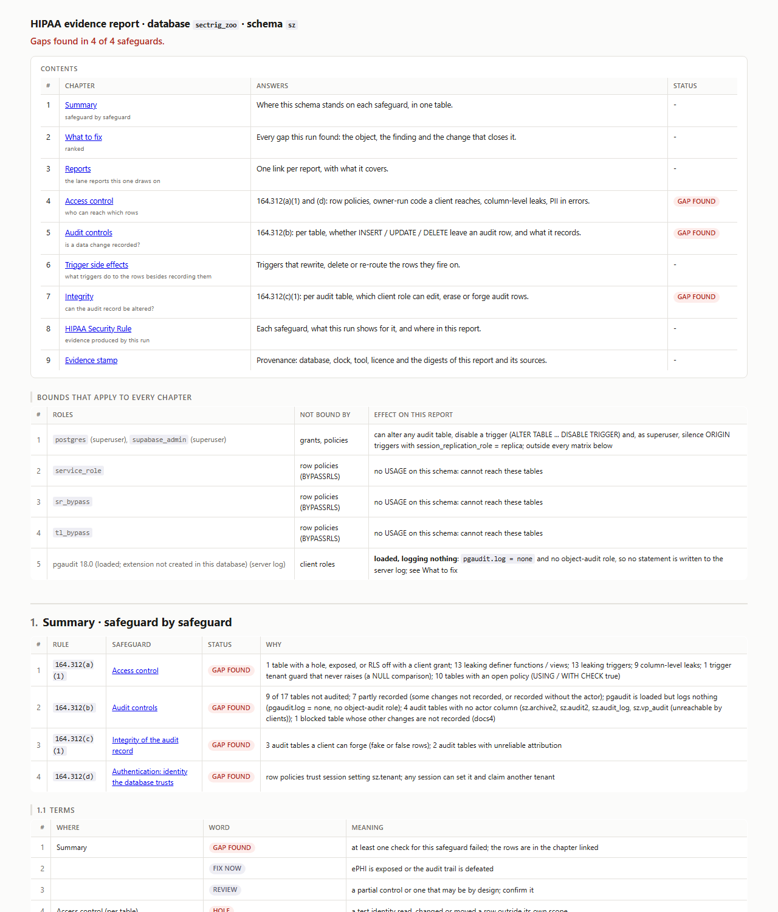
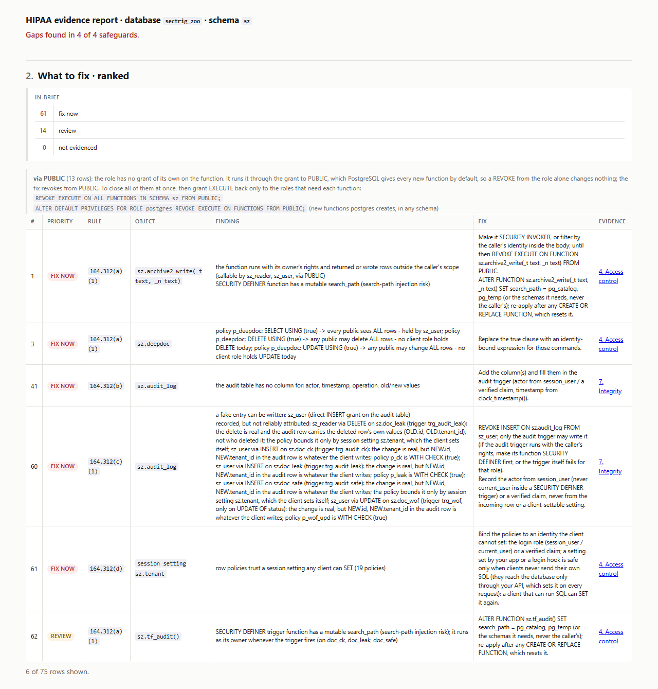

# HIPAA evidence (`unitautogen hipaa`)

`unitautogen hipaa` is its own module. It runs the full seccover pass (RLS policies, `SECURITY DEFINER`
functions, views, triggers, column grants, PII in errors) and adds the one check seccover alone does not
make: the **audit-log check**. For each table it shows whether every `INSERT`, `UPDATE` and `DELETE` is
recorded, where, with which values, and whether that record can be altered. The audit-log check only reads
the catalog and the test results.

It writes one standalone, stamped report covering access control, audit controls, integrity and
authentication, mapped to the HIPAA Security Rule. **Enterprise edition.**

```
unitautogen hipaa --schema public --out unitautogen_tests
```

## Options and output

- The seccover options: `--schema`, `--out`, `--sec-gate` and the rest (see [commands](commands.md#3-seccover---security-coverage-enterprise-licence)).
- `--config FILE` declares audit or PHI tables the tool missed. `./unitautogen.toml` is read automatically. See [the config file](config-file.md).
- `--storage` also checks Supabase Storage policies and public buckets (below).
- The report is `<out>/hipaa/<schema>/hipaa_report.html`, with `hipaa_report.json` beside it. It links the seccover and unit reports for detail.
- On Supabase, `unitautogen --supabase hipaa --schema public` writes to `supabase/tests/seccover/hipaa/<schema>/` and turns on `--storage`.
- Like every command, the run installs its pgTAP test schemas in the target database and drops them at the end.
- Without an Enterprise licence it reports `NOT LICENSED`, generates nothing, and exits with code 5.

## Where its tests are

`hipaa` writes no tests of its own. The tests behind its report are these:

| Evidence | Folder | Written by |
| --- | --- | --- |
| Access control - functions, views, triggers | `<out>/security/<schema>/functions/`, `views/`, `triggers/` | seccover |
| Access control - RLS policies | `<out>/security/<schema>/rls/` | seccover |
| Access control - column-level security | `<out>/security/<schema>/cls/` | seccover |
| Audit controls and integrity | `<out>/unit/<schema>/triggers/` | trigger unit tests |
| PII in error messages | `<out>/pii_tests/` | pii |

- The report's Evidence links open these files, and the evidence stamp records each file's SHA-256.
- To re-run the evidence, run the suites in `security/` and `unit/`. See [CI/CD](ci-cd.md).
- With `--no-emit-tests` the suites run and are then removed, and the report says so.

## The HIPAA report

The report reads like a short book. A contents table shows each chapter, what it answers, and which
chapters found a gap. Each chapter opens with an *In brief* box before its detail tables. Above chapter 1, a
**Bounds** table lists the roles the matrices cannot bind - superusers, the schema owner, `BYPASSRLS` roles,
`TRUNCATE` holders - and the pgaudit state. The scope is the database layer.



A run on a fixture schema built to fail, with gaps in 4 of 4 safeguards.

| Chapter | What it shows |
| --- | --- |
| 1. Summary | One row per safeguard - 164.312(a)(1) access control, (b) audit controls, (c)(1) integrity of the audit record, (d) authentication - marked *gap found*, *partly tested*, *no gaps found*, *not applicable* or *not tested*, with the reason. |
| 2. What to fix | Every gap with its priority, HIPAA rule, object, finding, the database change that closes it, and the chapter with the evidence. Fixes that exist only because PostgreSQL grants `EXECUTE` to `PUBLIC` by default are marked and explained once, with the `REVOKE` that closes them all. |
| 3. Reports | One row per report this one draws on, with what it covers and a link. |
| 4. Access control | 164.312(a)(1) and (d). The RLS test identities, the RLS policy verdict per table, and every `SECURITY DEFINER` function, view and trigger a client reaches, with its verdict. Plus RLS bypass surfaces, column-grant leaks and PII-in-error findings. |
| 5. Audit controls | 164.312(b). One row per data table with a cell per `INSERT`, `UPDATE` and `DELETE`. A cell reads *recorded* when a passing trigger test made the change and asserted the audit row. It reads *partly recorded* when the audit table has no actor column, the row is not asserted by a test, or a condition decides whether it is written. Other cells read *cancelled*, *not tested*, *not recorded* or *audit trigger off*. The row also lists what the audit table has no column for (actor, timestamp, operation, old and new values). When pgaudit is installed, the report reads its settings and adds what it logs per role. |
| 6. Trigger side effects | Triggers that change the ePHI rows themselves: rewriting a column, deleting or updating other rows, writing into another schema, cancelling or rejecting the change, or failing open. |
| 7. Integrity | 164.312(c)(1). For each audit table and client role: can it forge, alter, erase or truncate audit rows, or add a trigger that does? Verdicts: *tamper-proof*, *forgeable*, *editable*, *misattributable*, *unresolved*, *unreachable* or *unknown*. |
| 8. HIPAA Security Rule | One row per safeguard the database layer evidences - 164.312(a)(1), (b), (c)(1), (d) and 164.308(a)(8) evaluation - with links to the chapters that hold the evidence. |
| 9. Evidence stamp | Database, schema, server version, the database-clock timestamp, the connection role, tool version and licence. The SHA-256 of the report, of every source file it read, and of every emitted test suite. An edited copy no longer matches. |

The ranked *What to fix* list, with the `via PUBLIC` note above it:



## What it covers, and what it does not

The report is evidence for the safeguards the **database layer** can show:

| Rule | Safeguard | What the report shows |
| --- | --- | --- |
| 164.312(a)(1) | Access control | Each tenant's rows are reachable only by that tenant, across RLS policies, owner-run functions, views, triggers and column grants. |
| 164.312(b) | Audit controls | Whether each data change is recorded, where, and with which values. |
| 164.312(c)(1) | Integrity | Whether a client role can forge, alter or erase the audit record. |
| 164.312(d) | Person or entity authentication | What identity the row policies trust, and whether a client can claim another one. |
| 164.308(a)(8) | Evaluation | Run on every deploy, the dated reports show the controls were evaluated over time. |

Safeguards outside the database layer - encryption, transmission security, login verification, review of
activity logs, and administrative procedures - are not listed. They stay with you.

This is supporting evidence for your assessor, not a certification. It is produced on your own
infrastructure; nothing leaves your perimeter.

## Audit tables the tool did not find

An audit table is one that a trigger writes a record of each change into. The tool finds these itself. A
table a trigger writes into counts as an audit table when:

- its name contains `audit`, `log`, `history`, `journal`, `trail`, `change` or `archiv`, or ends in `event`,
  `version` or `revision` (singular or plural); or
- it has two or more audit-style columns, such as `changed_by`, `changed_at`, `operation`, `old_data`,
  `new_data`, `actor` or `record_id`.

If your audit table has a different name and columns - say `public.activity` - the trigger's write is
treated as an ordinary write, and the changes it records do not count as recorded under Audit controls.
List the missed tables in the [config file](config-file.md):

```toml
[audit]
tables = ["public.activity", "billing.ledger"]
```

- The same section removes a wrong guess with `not`, and `[audit.map]` states which audit table a table must
  log to.
- It only matters for a table a trigger writes into.
- To check it worked, look at the table's box in the Integrity chapter. Its *recognised by* line reads
  *from config file*.

Which tables and columns hold PHI is decided automatically. Where the tool gets it wrong, correct it in the
config file under `[phi]`.

## Supabase Storage (`--storage`)

Supabase keeps a row in `storage.objects` for every stored file - photos, PDFs, scans. The RLS policies on
that table decide who can open, upload, change or delete each file. A **public** bucket lets anyone with a
file's link download it, and its policies are not checked for downloads. Add `--storage` to check them.
With `--supabase`, every security command turns it on by itself.

```
unitautogen hipaa --schema public --storage
unitautogen seccover --schema public --storage
```

- It runs the RLS policy tests on `storage.objects` and `storage.buckets`, and the public-bucket check.
  Nothing else runs there, since those functions and tables are Supabase's own.
- Reports go to `<out>/security/storage/rls_report.html`. With `hipaa`,
  `<out>/hipaa/storage/hipaa_report.html` covers access control only.
- For each public bucket it also tests who can **list** its files. It plants one test file owned by one user
  (rolled back afterwards), then tries to list it as an anonymous user and as another signed-in user.

| Result | Priority | What it means |
| --- | --- | --- |
| A stranger can list the file | *fix now* | Anyone can find every file and download it. |
| Listing denied to both | *review* | A file is reached only by someone who knows its path. The bucket may be public on purpose (profile pictures). |
| Not tested | *review* | The connection could not plant a test file (it needs a superuser or the table owner). The finding says why. |

The fix is `UPDATE storage.buckets SET public = false WHERE id = '<bucket>';`, and for *fix now* also
narrowing the `SELECT` policy on `storage.objects` so only a file's owner can list it.

- `--storage` needs `seccover`, `pii` or `hipaa`. Alone it is ignored with a message.
- A database without the storage tables is skipped with a message.
- If you name `storage` in `--schema` yourself, it is an ordinary schema and every check runs on it.

## Use it to

- Hand an assessor reproducible technical evidence for access control, audit controls and integrity at the
  database layer.
- Get a ranked list of the database changes that close each gap.
