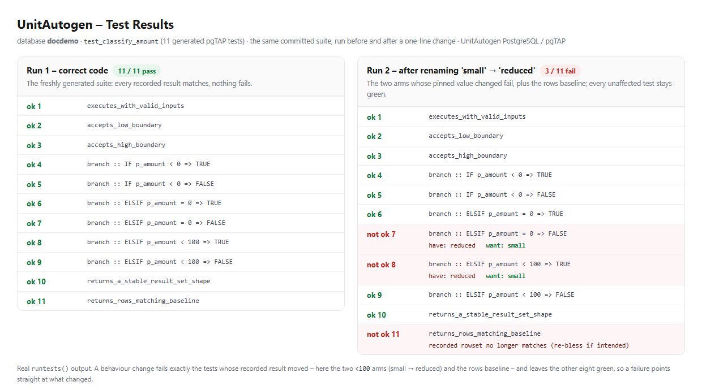

# Worked example: a passing test and a failing test

This section walks through real output. The routine under test is a small discount classifier:

```
CREATE FUNCTION classify_amount(p_amount numeric) RETURNS text AS $$
BEGIN
    IF     p_amount < 0   THEN RETURN 'negative';
    ELSIF  p_amount = 0   THEN RETURN 'zero';
    ELSIF  p_amount < 100 THEN RETURN 'small';
    ELSE                       RETURN 'large';
    END IF;
END;
$$ LANGUAGE plpgsql;
```

Running `unitautogen --schema public` generated **11 tests** at
**100% branch / 100% statement**. Each decision produced a true-side and a false-side test, and
the generator recorded the routine's actual output for each as the expected value. Two of the generated
tests:

```
-- test_08 : the "< 100" decision, TRUE side (input 1)
RETURN NEXT is( (public.classify_amount((1)::numeric))::text,
                'small',
                'branch :: ELSIF p_amount < 100  =>  TRUE :: returns' );

-- test_09 : the "< 100" decision, FALSE side (input 100)
RETURN NEXT is( (public.classify_amount((100)::numeric))::text,
                'large',
                'branch :: ELSIF p_amount < 100  =>  FALSE :: returns' );
```

## 7.1 All tests pass on the correct code PASS

Running the generated suite against the routine as written:

```
ok 7  - test_classify_amount.test_07_branch_elsif_p_amount_0_false
ok 8  - test_classify_amount.test_08_branch_elsif_p_amount_100_true
ok 9  - test_classify_amount.test_09_branch_elsif_p_amount_100_false
ok 10 - test_classify_amount.test_10_returns_a_stable_result_set_shape
ok 11 - test_classify_amount.test_11_returns_rows_matching_baseline
1..11
```

**Why test\_09 passes:** it calls `classify_amount(100)` and asserts the
result is `'large'`. The routine takes the ELSE branch for 100 and returns
`'large'`, which matches the recorded expected value - so the assertion holds. Each
passing line means "the routine still does, for this input, exactly what it did when the test was written."

## 7.2 The same tests fail after a code change FAIL

Now suppose a developer renames the middle tier - a one-line change, "small" becomes "reduced":

```
-    ELSIF  p_amount < 100 THEN RETURN 'small';
+    ELSIF  p_amount < 100 THEN RETURN 'reduced';
```

Re-running the *same, unchanged* generated tests:

```
ok 6  - test_classify_amount.test_06_branch_elsif_p_amount_0_true
not ok 7 - test_classify_amount.test_07_branch_elsif_p_amount_0_false
    # Failed test 7: "branch :: ELSIF p_amount = 0  =>  FALSE :: returns"
    #         have: reduced
    #         want: small
not ok 8 - test_classify_amount.test_08_branch_elsif_p_amount_100_true
    # Failed test 8: "branch :: ELSIF p_amount < 100  =>  TRUE :: returns"
    #         have: reduced
    #         want: small
ok 9  - test_classify_amount.test_09_branch_elsif_p_amount_100_false
not ok 11 - test_classify_amount.test_11_returns_rows_matching_baseline
    # (re-bless: accept the new output as the baseline once it is intended)
1..11
# Looks like you failed 3 tests of 11
```

**Why test\_08 fails:** it calls `classify_amount(1)` and still expects
`'small'` - the value the routine returned when the test was generated. The changed
routine now returns `'reduced'`, so pgTAP reports
`have: reduced / want: small`. The test did its job: it caught that the routine's
observable behaviour changed for an input it used to handle a certain way.

**Why test\_09 still passes:** the change did not touch the ELSE branch. For input 100 the
routine still returns `'large'`, which still matches the expected value - so test\_09
stays green. This is the useful contrast: a real behaviour change fails exactly the tests whose recorded
result changed, and leaves the rest passing, so a failure points straight at what moved.

### The same runs, as an HTML report

Rendered as a test-results report - the passes in green, the three regressions in red with their
`have`/`want` difference:



Run 1 (correct code) - 11/11 pass. Run 2 (after the one-line change) - the two arms whose pinned
value changed fail, plus the rows-baseline check; every unaffected test stays green.

**How this relates to the guarantee.** A freshly generated suite is always all-green, because
the generator records the routine's current behaviour as the expected value and drops any test that will
not pass cleanly. A failing test therefore never appears in a first run - it appears later, when your code
changes in a way that alters behaviour a test had pinned. That is precisely what a regression test is for:
the failure in §7.2 is the desired outcome of changing behaviour, not a defect in the tests.
